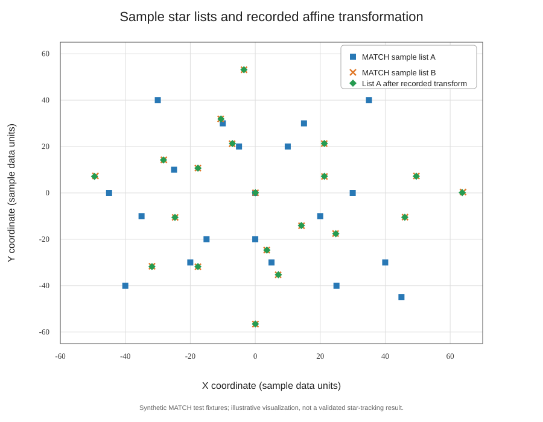

# Small-Satellite Tracking Study

**Documentation and exploratory study** of astronomical star-list matching and geometric coordinate transformations, originating in a research internship related to small-satellite tracking.

## About this repository

This repository preserves and organizes technical material from an early exploration of **MATCH**, an open-source astronomical program developed by Michael W. Richmond to establish correspondences between lists of astronomical objects.

The study examined whether software of this kind could help associate observed stars with a reference catalog, and explored comparing tracker observations with mathematically projected stellar positions. The approach was exploratory and used relatively simple geometric methods.

The repository is intended as a record of that study: its references, third-party software, sample data, notes, and a small notebook. It is **not** a complete star tracker or a finished satellite-tracking application.

## My role

My work consisted of studying and experimenting with existing open-source software, examining sample star lists, exploring coordinate transformations, organizing technical information, and considering possible applications to small-satellite tracking.

The MATCH program itself was developed by Michael W. Richmond. It is retained here as third-party software; it is not my original code.

## Exploratory visualization

The notebook plots two sample catalogs distributed with MATCH and applies a set of affine-transformation coefficients preserved from the original experiment.

The coefficients are recorded values from that experiment. Their derivation is not documented in this repository, and the notebook does not reproduce an estimation procedure for them. The plotted catalogs are synthetic MATCH test fixtures, not observations collected by the author.

## Related later work

A later doctoral research project at the University of Chile developed SOST (SPEL Open Star Tracker), an open-source star tracker for nanosatellites. That work used established open-source astronomy software, including MATCH, as part of its Lost-In-Space attitude-determination algorithm.

This repository is **not part of the SOST development and does not claim any contribution to that doctoral thesis**. The later work is referenced only as related work: it shows that the same class of astronomical software explored in this earlier study was subsequently used in a more developed star-tracker system.

See [`docs/related-work.md`](docs/related-work.md) for more context.

## Repository contents

- `analysis/`: exploratory notebook and notes about the analysis.
- `docs/`: related-work notes and a static visualization of the notebook.
- `third_party/MATCH/`: original MATCH distribution, its license/copyright notices, and sample data.
- `requirements.txt`: Python dependencies used by the notebook.

## Status and validation

This is a historical research record, not a maintained software product. The notebook reads and plots two sample star lists, then applies the recorded affine transformation to one list for visual comparison. It does not implement a complete star-identification algorithm or spacecraft-attitude solution.

The notebook has been executed successfully in GitHub Actions using Python 3.11. The workflow checks that the notebook's dependencies and sample-data paths work; it does not validate the scientific accuracy of the approach.
